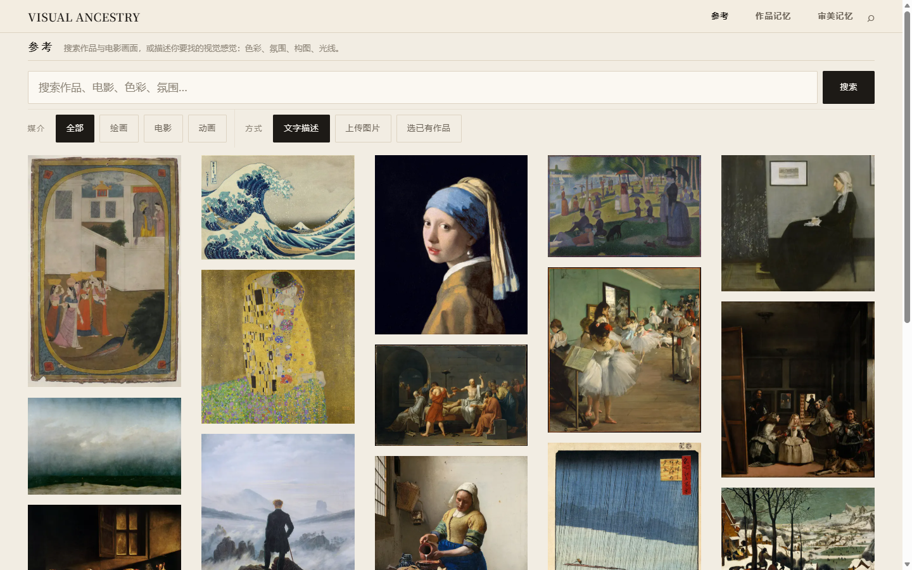
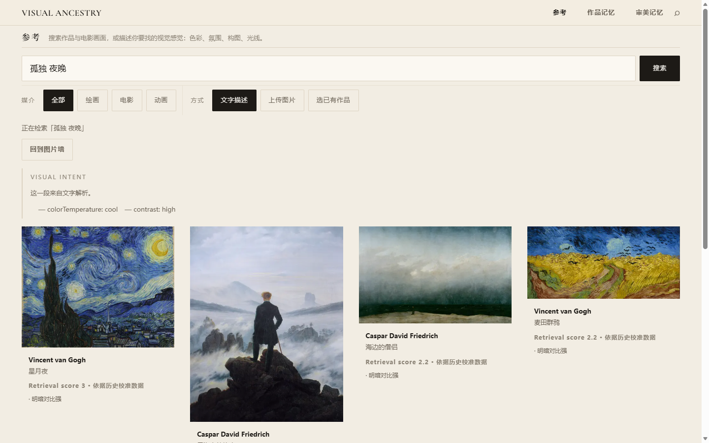
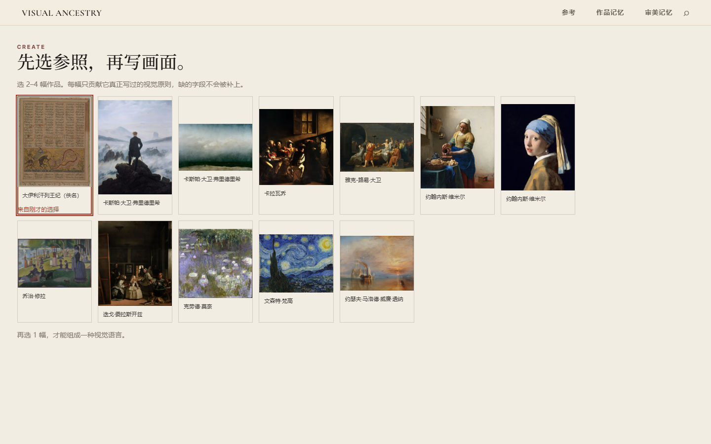
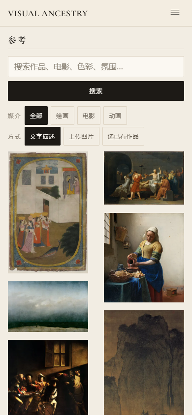

# Visual Ancestry

> Find paintings with a filmmaker's eye; write shots with a painter's structure.
> A visual research desk that searches public-domain paintings and film stills,
> reads verifiable analysis of them, and turns a selection into a creation brief.

[中文](./README.md) · [Architecture & data flow](./docs/ARCHITECTURE.md) · [Acceptance report](./docs/ACCEPTANCE-REPORT.md) · [Demo script](./docs/DEMO-SCRIPT.md) · [Agent Skill](./skill/visual-ancestry/SKILL.md)



<p align="center">
  
  
</p>

<p align="center">
  
</p>

---

## What it is

A zero-framework web app plus a Node Agent Skill, sharing one implementation of
retrieval and analysis.

- **FIND** — search 51 public-domain paintings and film stills; optionally layer in
  live Wikimedia Commons discovery.
- **CREATE** — pick 2–4 references, generate a prompt, export Markdown.
- **SHOOT** — turn selected visual principles into executable shooting guidance.
- **MEMORY** — visual and aesthetic memory, exportable as a portable archive.
- **Vision (optional)** — image upload analysis. **Without a provider it reports
  unavailable; it never pretends to have worked.**

## Requirements

| Item | Requirement |
|---|---|
| Node.js | **≥ 20** (built-in `fetch`, `node:crypto`) |
| Runtime dependencies | **None.** Node built-ins only — no `npm install` needed |
| Optional dependency | `sharp` — only for `npm run build` |

## Run it (Windows PowerShell)

```powershell
# 1. Enter the directory
cd <unpacked-directory>

# 2. Start (serves the source tree — no build step required)
$env:PORT = 5173
npm start
```

Or without npm:

```powershell
node scripts/server.mjs . 5173
```

Then open <http://127.0.0.1:5173>.

> The server's default static root is `dist/` (build output). `node scripts/server.mjs .`
> is an **explicit** choice to serve the source tree — the project directory holds
> `.env`, and a wrong default root is exactly how `GET /.env` leaked historically.
> An allow-list guard refuses both.

## Configure Vision (optional)

Everything works without it — retrieval, analysis, CREATE, SHOOT, MEMORY. Only
"upload an image / search by image" is unavailable.

```powershell
Copy-Item .env.example .env
$env:VISION_API_BASE = "https://.../v1/chat/completions"
$env:VISION_API_KEY = "..."
node scripts/server.mjs . 5173
```

Fail-closed default: if a provider is configured but **no budget ledger is set, the
server refuses to call it**. A forgotten budget never silently opens a paid key.
Full variable reference: [`.env.example`](./.env.example).

## Agent Skill

```bash
node skill/visual-ancestry/scripts/va.mjs search "lonely night" --limit 5
node skill/visual-ancestry/scripts/va.mjs intent bahram-gur-karg
node skill/visual-ancestry/scripts/va.mjs plan --refs bahram-gur-karg,the-kiss --out plan.md
node skill/visual-ancestry/scripts/va.mjs vision-status
```

The skill **imports the same retrieval and analysis modules the web app runs** — it
does not carry a second, divergent film-search implementation. With no Vision
provider it reports unavailability rather than passing local retrieval off as
image understanding. See [`skill/visual-ancestry/SKILL.md`](./skill/visual-ancestry/SKILL.md).

## Layout

| Path | Contents |
|---|---|
| `index.html` | Entry; default skin is the "album" scheme |
| `src/pages/` | Route-level pages: `find` / `create` / `shoot` / `memory` |
| `src/services/retrieval/` | Retrieval and scoring (shared with the skill) |
| `src/services/source/` | External sources: Commons discovery, film concept splitting, rights adjudication |
| `src/services/vision/` | Vision analysis contract and normalisation |
| `src/data/` | Archive data (artworks, film stills, VisualIntent records) |
| `server/security/` | Access control, budget ledger, static path guard |
| `scripts/server.mjs` | Static server + Vision API |
| `public/assets/` | Local images (thumb / preview / detail tiers) |
| `qa/` | Runnable acceptance harnesses (no browser profiles or screenshot evidence) |
| `docs/` | Architecture notes and stage reports |

## Capability boundaries (honest list)

**Implemented and verified for real**

- Retrieval across 51 local records (paintings + film stills) with scores and match reasons
- Live Wikimedia Commons film-still discovery with concept splitting and rights checks
- 46 VisualIntent analysis records, each returned with provenance and source link
- CREATE reference selection → prompt generation → copy / Markdown export
- TaskContext reference carry-over between pages
- Memory export and re-import

**Not finished / unavailable**

- **Vision upload analysis**: no provider configured; the UI honestly shows `not-configured`
- **Film still coverage**: only what the archive contains; not expanded
- **Animation**: the retrieval pipeline supports the `animation` medium, but the local
  archive has no animation works, so it reports an honest empty state rather than
  silently falling through to "all"
- No accounts, no cloud persistence, no native mobile shell

## Asset licensing

Code is MIT. Image assets are licensed **per item** — see [`LICENSE`](./LICENSE) and
`src/data/artworks/*`, `src/data/filmStills*.js`:

- 46 paintings are public domain, sourced from museum open-access records and Wikimedia Commons
- 5 still-in-copyright modern works carry **no bundled image**, only the record
- Film stills come from Wikimedia Commons under each entry's own label

## Minimal real acceptance

```powershell
npm start
# open http://127.0.0.1:5173
#   1. Search "lonely night" → hits with reasons
#   2. Open a work → side panel with "use as reference"
#   3. Go to CREATE (#create) → that reference should be first and selected
#   4. Select 2 → generate prompt → export Markdown
# 5. Skill (second terminal)
node skill/visual-ancestry/scripts/va.mjs search "lonely night" --limit 3
node skill/visual-ancestry/scripts/va.mjs plan --refs bahram-gur-karg --out plan.md
```

Harnesses (require local Edge): `node qa/ui/ui-final-acceptance.mjs`,
`node qa/find/edge-cdp-e2e.mjs`, `node qa/ui/round3-check.mjs`.

## Data & privacy

- Visual memory lives in browser localStorage; export and clear are one click.
- Vision credentials exist only in the server process environment; the build output
  contains no `VISION_*` values.
