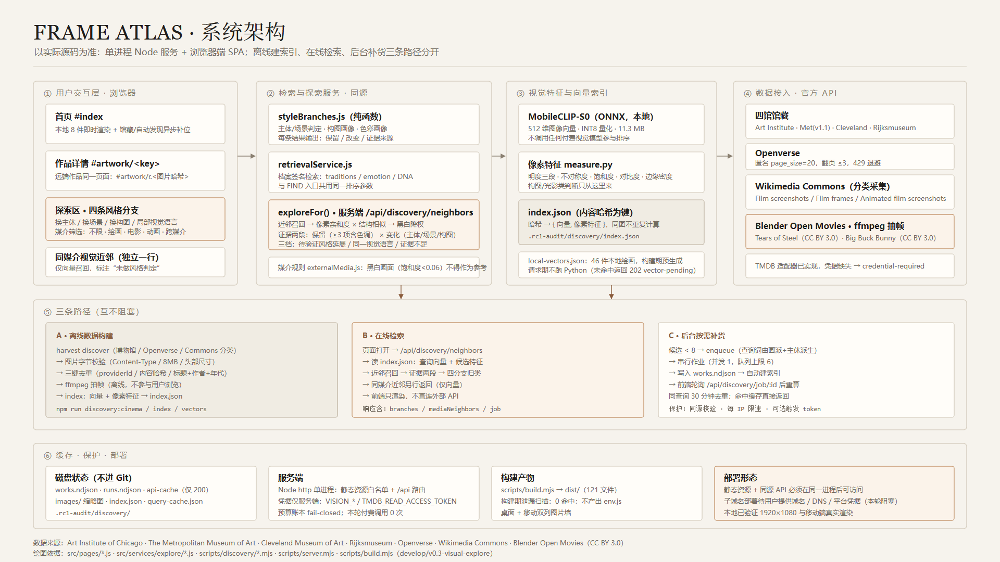

# Frame Atlas

**从一张图，找到它真正的视觉祖先。** 上传或选择一件作品，系统用本地视觉索引跨馆检索同源图像，并沿"保留画派、只换一个维度"的方向继续探索；必要时再把图片交给视觉模型做对照，只返回有证据的关联。

这不是一个"AI 生成相似图片"的产品：库里每一张都是真实馆藏或开放授权影片画面，每一条推荐都能点回原始来源。

---

## 一、怎么用

1. **首页**（`#index`）：本地 8 件作品即时显示，随后异步补入馆藏与自动发现图；搜索框支持文字描述、上传图片、选已有作品三种入口。
2. **作品详情**（`#artwork/<key>`）：大图 + 作者/年代 + 「WHY IT WORKS」+「EXPLORE」+「Artwork facts」。
3. **探索区**：四条分支（换主体 / 换场景 / 换构图 / 局部视觉语言），每条都写清保留了什么、改变了什么、证据来源；上方「同媒介视觉近邻」单独一行，只做同媒介向量召回。
4. **跨媒介**：媒介切到「彩色电影」「动画」即可看到真实影片画面作为参考候选；点进去仍是同一个详情页。
5. **连续探索**：任何外部作品都有内部地址（`#artwork/r.<图片哈希>`），可以直接刷新打开，也可以作为下一轮探索的起点。

---

## 二、当前版本

| 项 | 值 |
|---|---|
| 版本 | v0.3.0（`develop/v0.3-visual-explore`） |
| 正式网址 | **待部署**（见第九节：缺少域名/DNS/平台凭据，本轮阻塞） |
| 演示视频 | `.rc1-audit/demo/frame-atlas-demo.mp4`（1920×1080 · H.264 · 89.6 秒 · 真实浏览器录制） |
| 架构图 | `docs/architecture/frame-atlas-architecture.svg` / `.png`（1920×1080） |
| 部署平台 | 暂未部署；本地生产构建已验证 |

---

## 三、技术架构



单进程 Node 服务 + 浏览器端 SPA，三条路径互不阻塞：

- **离线构建**：采集 → 字节校验 → 三键去重 → ffmpeg 抽帧 → 向量与像素特征写入 `index.json`。
- **在线检索**：页面只调同源 `/api/discovery/neighbors`，读索引、算证据、归类四分支；浏览器不直连外部 API。
- **后台补货**：候选不足时入队串行作业（并发 1、队列 6、同查询 30 分钟去重），前端轮询任务状态。

视觉侧不训练模型：`MobileCLIP-S0`（ONNX，512 维，11.3 MB）负责召回；构图/光影类判断来自像素实测（明度三段、不对称度、饱和度、对比度、边缘密度）。**付费视觉模型不参与排序**。

---

## 四、已完成模块

| 模块 | 状态 | 说明 |
|---|---|---|
| 首页图片墙（本地 + 远端混排） | ✅ | 双键去重、坏图剔除、移动双列 |
| 作品详情统一页 | ✅ | 本地与外部作品同一套；外部作品 `#artwork/r.<hash>` |
| 四条风格分支 | ✅ | 证据两段（保留 × 变化），三档表述，从不写"已验证" |
| 媒介筛选（五档） | ✅ | 黑白画面不作为参考；外部候选不因重绘丢失 |
| 四馆馆藏接入 | ✅ | Met(v1.1) / Cleveland / Rijksmuseum 有数据；AIC 适配器可用但本轮 0 件入库 |
| Commons 分类采集 | ✅ | 电影/动画画面分类，许可与元数据双重门槛 |
| Blender 开放影片抽帧 | ✅ | Tears of Steel、Big Buck Bunny；带影片名与时间戳 |
| 按需补货 + 限速保护 | ✅ | 同源校验、每 IP 限速、可选触发 token |
| 跨媒介探索 | ⚠️ 可用但弱 | 见第七节实测 |
| TMDB（电影剧照/剧集） | ❌ 未验收 | 无凭据，标记 `credential-required` |
| 商业日漫 | ❌ 未接入 | 第三方站点截图不等于索引授权 |
| 子域名部署 | ❌ 阻塞 | 缺域名/DNS/平台凭据 |

**功能完成率：9 / 12 = 75%**（分母为上表 12 项既定功能；⚠️ 计为完成但质量受限，❌ 计为未完成）。

---

## 五、数据覆盖（样本量，不是行业覆盖率）

| 来源 | 数量 | 性质 |
|---|---|---|
| Cleveland Museum of Art | 89 | 馆藏作品 |
| The Metropolitan Museum of Art | 107 | 馆藏作品 |
| Openverse | 74 | 开放图像（CC 授权，含各馆上传件） |
| Rijksmuseum | 26 | 馆藏作品 |
| Wikimedia Commons | 202 | 作品 178 + 电影画面 14 + 动画画面 10 |
| Blender Open Movies | 20 | 抽帧：电影 10 + 动画 10 |
| AniList | 20 | **目录封面，不是画面** |
| **合计** | **538** | 索引条目 553（含历史版本图片） |

- 本地精选绘画：46 件（有预生成向量）。
- **电影画面 23 张**（Blender 10 + Commons 13），其中 7 张黑白，可作参考 16 张。
- **动画画面 20 张**（Blender 10 + Commons 10），其中 1 张黑白，可作参考 19 张。
- TMDB：0 张（无凭据）。

---

## 六、搜索质量（Phase 2.2B 人工复核）

四条跨媒介路径 × 3 个真实起点 × 4 张候选 = **48 张逐张人工复核**：

| 判定 | 数量 | 比例 |
|---|---|---|
| 有效（能说出构图/色彩/光影对应） | 3 | 6.3% |
| 弱（同媒介但只有笼统气质相近） | 24 | 50% |
| 错误（内容与结构都无关） | 21 | 43.8% |
| 无候选 | 0 | 0% |

结论：**跨媒介可以探索，但只能作为"值得一看的参考"，不能宣称风格一致。** 512 维 MobileCLIP-S0 的余弦衡量的是同一媒介内的内容相似，抓不住跨媒介真正可解释的结构对应。报告见 `docs/p2/PHASE2.2B-REPORT.md`。

同一媒介内（绘画→绘画）质量明显更好：四条分支要求"画派交集 + 明确维度变化"，不足就留空。

---

## 七、测试结果

| 类别 | 结果 |
|---|---|
| 单元测试 | **543 / 543 PASS（23 套件）** |
| 端到端（连续探索，真实浏览器） | **15 / 15 PASS** |
| 端到端（电影/动画媒介） | **9 / 9 PASS** |
| 视觉质量人工复核 | **48 张：有效 3 / 弱 24 / 错误 21** |
| 构建 | `dist/` 320 文件；构建期泄漏扫描 0 命中 |
| 付费视觉调用 | **0 次**（预算账本 15/17 未动） |

---

## 八、数据来源、许可与版权

- **四馆**：均为馆方开放数据 API，使用其公开接口；作品权利状态随接口字段显示。
- **Openverse / Commons**：只收公有领域、CC0、CC BY、CC BY-SA；许可字段缺失或 `fair use` 一律跳过。
- **Blender Open Movies**：Tears of Steel、Big Buck Bunny 均为 **CC BY 3.0**，署名 Blender Foundation；视频与抽帧只存本地（`.rc1-audit/`，不进 Git），不随产品分发。
- **TMDB**：适配器已实现但未启用，未取任何数据。
- 产品内展示每一件外部作品都带「原始馆藏 ↗」外链。

---

## 九、实际限制（不粉饰）

1. **跨媒介弱**：见第六节，有效仅 6.3%。
2. **黑白画面被排除**：饱和度 < 0.06 的影片画面（含部分默片）不作为参考，这是产品政策。
3. **商业日漫未覆盖**：动画素材是公有领域早期动画 + CC BY 的 Big Buck Bunny，**不代表商业日漫**。
4. **TMDB 未验收**：没有凭据就没有数据，界面不假装有。
5. **Commons 质量参差**：分类成员由上传者自述；已用许可 + 元数据 + 标题三重过滤，并人工移除 1 条片名字卡，但**没有逐张复核全部 202 件**。
6. **未部署**：本轮缺域名/DNS/平台凭据，子域名与正式网址为空。
7. **种子池小**：538 件，其中绘画 281、照片 194；跨媒介时可选面窄。
8. **AIC 本轮 0 件**：适配器正常返回结果，但图片未能通过校验（IIIF 地址），数据集里没有 AIC 条目；这一条不写成"已覆盖四馆"。

---

## 十、本地运行

```powershell
npm install
npm run build                 # 生产构建 → dist/
node scripts/server.mjs . 4600  # 静态 + 同源 API
# 打开 http://127.0.0.1:4600
```

可选：自动发现需要一次离线准备（图片与索引都在 `.rc1-audit/`，不进 Git）：

```powershell
npm run discovery:cinema        # Commons 分类 + Blender 抽帧（需 ffmpeg）
npm run discovery:index         # 向量 + 像素特征
npm run discovery:vectors       # 本地绘画的查询向量
npm run discovery:status
```

环境变量见 `.env.example`：视觉模型与 TMDB 凭据**只在服务端**，不填也能浏览与探索。
