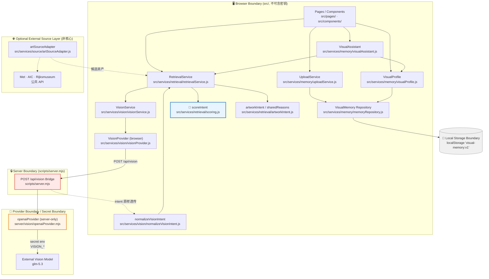

# ARCHITECTURE_CURRENT

**生成日期**：2026-10-08
**依据**：实际源码（`src/`、`server/`、`scripts/`）扫描，**未凭空绘制未来架构**
**阶段**：P6.3.1D

---

## PART B — 真实架构图



### 边界标注

| 边界 | 位置 | 含义 |
|---|---|---|
| **Browser** | `src/**` | 全部前端代码；**绝不含任何密钥** |
| **Server** | `scripts/server.mjs` | 唯一持有 `VISION_*` 的地方 |
| **Secret** | `server/vision/openaiProvider.mjs` | 只读env；不写盘、不下发浏览器 |
| **Provider** | `fetch(VISION_API_BASE)` | 跨网络边界 |
| **Local storage** | `localStorage["visual-memory:v1"]` | 个人视觉记忆持久化 |
| **Optional external source** | `src/services/source/artSourceAdapter.js` | **可选**，不影响核心链路 |

### 两条主链

**视觉理解链**
```
Browser → VisionService → browser VisionProvider → /api/vision Bridge
       → server openaiProvider → External Vision Model
```

**外部源链（可选）**
```
External Source Adapters → Candidate Discovery → Selected Asset Analysis
       → VisualIntent Cache（进程内 double-key）
```

**记忆消费链**
```
VisualMemory Repository → RetrievalService → scoreIntent / sharedReasons
       → VisualProfile → Personal Visual Assistant
```

---

## PART C — 每层职责

### 1. UI（Pages / Components）
- **文件**：`src/pages/*.js`（14 页）、`src/components/*.js`
- **输入**：用户交互、路由事件
- **输出**：渲染 DOM、触发 service 调用
- **负责**：呈现与交互
- **不负责**：不碰 intent、不做评分、不碰密钥
- **为何单独**：表现层变更不应波及检索语义
- **failure mode**：渲染错乱（不影响数据正确性）
- **frozen**：否
- **成本**：无 API / 无 storage / 无延迟

### 2. UploadService
- **文件**：`src/services/memory/uploadService.js`
- **输入**：`File` / `Blob`
- **输出**：`createVisualMemory(...)` → `addMemory`
- **负责**：图像 → memory 记录
- **不负责**：不做检索、不调provider
- **为何单独**：入口收敛，避免多处直接写 repository
- **failure mode**：base64/尺寸异常
- **frozen**：否
- **成本**：CPU（编码），无 API

### 3. VisionService
- **文件**：`src/services/vision/visionService.js`
- **输入**：`File`
- **输出**：normalized `VisualIntent`
- **负责**：编排 `prepareVisionImage` → `callVisionProvider` → `normalizeVisionIntent`
- **不负责**：不知道 provider 细节、不读 metadata
- **为何单独**：让上层只面对「图 → intent」
- **failure mode**：`provider-not-configured` 时回退文本输入
- **frozen**：否
- **成本**：调API；**每次调用 =一次延迟 + 费用**

### 4. VisionProvider（browser 侧）
- **文件**：`src/services/vision/visionProvider.js`
- **输入**：`File`
- **输出**：POST `/api/vision`
- **负责**：同源调用，**契约镜像**
- **不负责**：**绝不接触密钥**
- **为何单独**：唯一允许发请求的位置，便于集中审计
- **failure mode**：bridge 未启动 → 诚实失败
- **frozen**：否
- **成本**：一次 HTTP

### 5. `/api/vision` Bridge
- **文件**：`scripts/server.mjs`
- **输入**：`{ imageBase64, mimeType }`
- **输出**：`{ ok, intent, latencyMs }`（`result.raw` 原样透传）
- **负责**：注入密钥、校验 base64/mime、转发
- **不负责**：**不做 schema 校验**（见 E08）
- **为何单独**：密钥隔离的**唯一**屏障
- **failure mode**：502 `empty-response` / 503 未配置
- **frozen**：否
- **成本**：无外部成本

### 6. openaiProvider（Provider Adapter）
- **文件**：`server/vision/openaiProvider.mjs`
- **输入**：`Blob` + config
- **输出**：`{ ok, raw, latencyMs }`
- **负责**：构造 `buildSchema()`、注入 `Authorization`、解析 Chat Completions、失败分类
- **不负责**：不知浏览器存在、不写文件
- **为何单独**：隔离厂商差异
- **failure mode**：auth / quota / server / empty-response / invalid-json / timeout
- **frozen**：**是**（本项目自定义冻结）
- **成本**：**每次调用 = 一次 API 计费**

### 7. VisualMemory Repository
- **文件**：`src/services/memory/memoryRepository.js`
- **输入**：`VisualMemory[]`
- **输出**：读写 `localStorage["visual-memory:v1"]`
- **负责**：个人视觉记忆持久化
- **不负责**：不做检索、不调 API
- **为何单独**：存储唯一出入口
- **failure mode**：**浏览器配额**（实测1050 张 = 202.6 MB，已超20倍）
- **frozen**：否
- **成本**：storage 配额；**无延迟**

### 8. RetrievalService
- **文件**：`src/services/retrieval/retrievalService.js`
- **输入**：intent / 文本 / 图像
- **输出**：排序后的候选 + `sharedReasons`
- **负责**：编排 `scoreIntent` 与 `artworkIntent`
- **不负责**：**物理上不读 metadata**
- **为何单独**：检索语义唯一入口
- **failure mode**：intent 为空 → 无视觉依据
- **frozen**：否
- **成本**：CPU 0.13–0.93 ms

### 9. scoreIntent（🧊）
- **文件**：`src/services/retrieval/scoring.js`
- **输入**：`query intent` + `candidate intent`
- **输出**：数值score
- **负责**：纯函数打分
- **不负责**：**不调 API、不读 storage**
- **为何单独**：确定性核心，可测可冻结
- **failure mode**：无（纯函数）
- **frozen**：**是**（sha256 `7f165e2798…`）
- **成本**：零

### 10. artworkIntent / sharedReasons
- **文件**：`src/services/retrieval/artworkIntent.js`
- **输入**：策展文本
- **输出**：规则推导 intent + 「为什么匹配」
- **负责**：给静态藏品一个可用起点
- **不负责**：**不是真实视觉读数**
- **为何单独**：区分「推导」与「实测」
- **failure mode**：与真实 vision intent 混淆
- **frozen**：**是**
- **成本**：零

### 11. VisualProfile
- **文件**：`src/services/memory/visualProfile.js`
- **输入**：`VisualMemory[]`
- **输出**：聚合画像 + confidence
- **负责**：统计聚合、样本量门槛
- **不负责**：**不调 API**
- **为何单独**：画像是聚合结论，非单条结果
- **failure mode**：样本不足（`isProfileEligible`）
- **frozen**：**是**
- **成本**：零

### 12. VisualAssistant
- **文件**：`src/services/memory/visualAssistant.js`
- **输入**：自然语言 query
- **输出**：`understandTaste` / `findReference` / `creativeSupport`
- **负责**：薄解释层，组合 profile + retrieval
- **不负责**：**不做自主规划、不调 provider**
- **为何单独**：避免把 LLM 塞进决策链
- **failure mode**：grounding 泄漏
- **frozen**：**是**
- **成本**：零

### 13. Source Adapter（可选外部源）
- **文件**：`src/services/source/artSourceAdapter.js`
- **输入**：查询词
- **输出**：`metSource` / `aicSource` / `rijksSource` 候选
- **负责**：三家博物馆 API 适配
- **不负责**：**不判断内容类别是否正确**
- **为何单独**：厂商差异隔离；核心不依赖它
- **failure mode**：**参数名/IIIF 路径错误**（已踩3 次）
- **frozen**：否（P6.3 修正过 Rijks 参数）
- **成本**：外部 API（免费公开 API）

### 14. VisualIntent Cache
- **实现**：进程内，double-key `(source, sourceId)` + sha256
- **输入**：候选资产
- **输出**：缓存的 intent
- **负责**：避免重复分析
- **不负责**：**不跨进程、不持久化**
- **为何单独**：按需分析的成本控制
- **failure mode**：**环境性失败若被永久缓存 → 凭据到位后永久跳过**
- **frozen**：否
- **成本**：零；**实际省API 费用**

---

## PART D — 为什么这不是"大 Agent"

### 决策链是确定性的

产品从「图像」到「推荐」的每一步都是**固定函数**：

```
analyzeImage → normalizeVisionIntent → scoreIntent → render
```

中间**没有** LLM 自主决定「下一步做什么」。Assistant 是**薄解释层**：
它读取已算好的结果，用自然语言组织输出，不重新计算、不循环、不自省。

| 组件 | 是否自主决策 |
|---|---|
| 视觉理解 | 交给模型（唯一交给模型的部分） |
| Retrieval | **确定性**，固定 scoring |
| Profile | **确定性聚合** |
| Assistant | **薄解释层** |
| Source Adapter | **纯适配器** |
| 规划循环 | **不存在** |

### 这样做的优势

| 维度 | 优势 |
|---|---|
| **Cost** | 只有 vision 调用花钱；检索 0.13–0.93 ms、profile/assistant 零成本。自主 Agent 会反复调用 LLM，成本随步数线性增长 |
| **Latency** | 非 vision 步骤全部本地。瓶颈单一（provider），易定位 |
| **Debuggability** | 出错能精确定位到某一层。「推荐不对」→ 看 scoreIntent 输入输出，不需猜 LLM 意图 |
| **Reproducibility** | 同一 intent → 同一结果，**跨时间、跨机器一致**。模型采样随机性被隔离在 vision 一层 |
| **Security** | 密钥只在 server。浏览器永远拿不到凭据，无需防泄漏的 LLM 工具调用 |

### 为什么这更适合本产品

视觉记忆的价值在于**可复现的个人化推荐**。
如果引入自主规划，同一张图两次可能得到不同推荐 ——
这与「个人视觉记忆」的概念直接冲突。

**模型只负责它擅长的：看图。其余全部交给可测试的确定性代码。**