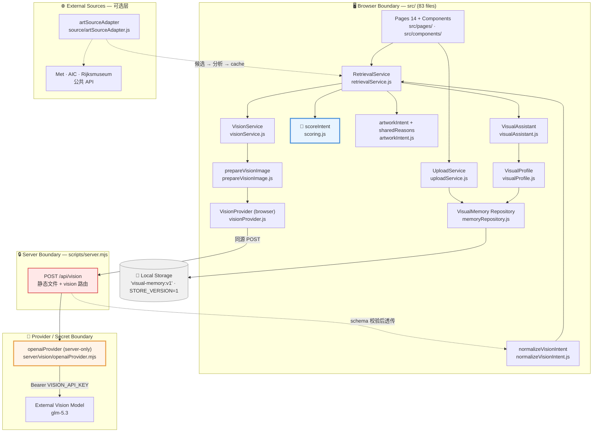
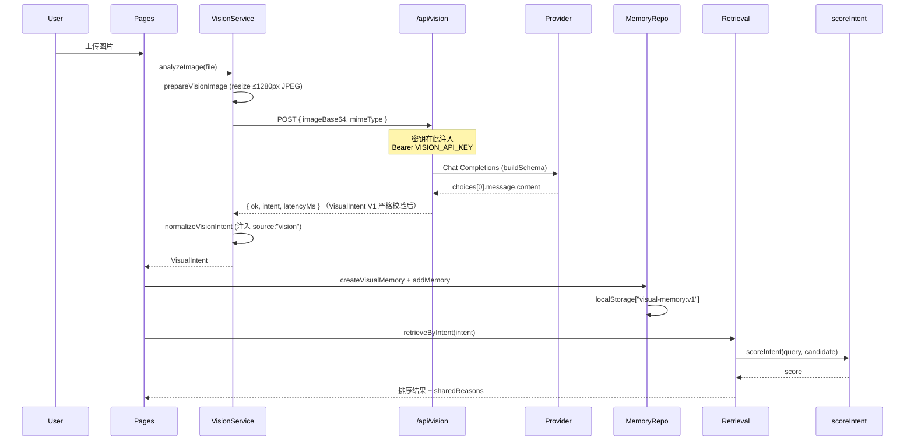
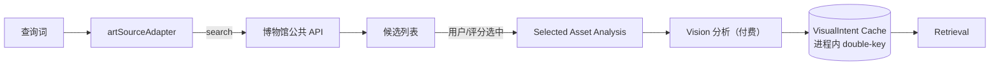
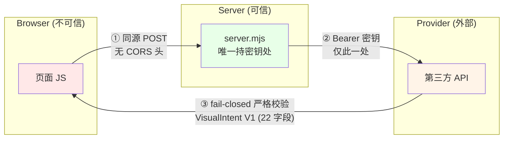

# ARCHITECTURE_CURRENT

**依据**：PHASE 0 实测的 imports 与模块（`src/` 83 files、`server/` 1 file、`scripts/` 21 files）
**禁止**：本文档不含任何未来/规划中的架构

---

## 1. Runtime Architecture



---

## 2. Data Flow



### 外部源链（可选）



**关键**：候选 ≠ 分析。只有被选中的资产才消耗 API 调用。

---

## 3. Trust / Security Boundaries



| # | 边界 | 保护措施 | 缺口 |
|---|---|---|---|
| ① | Browser → Server | **无 CORS 头** → 强制同源；6 MB body上限（`:46`）| 无速率限制（MEA-06）|
| ② | Server → Provider |密钥仅在 server env；`build.mjs` 扫描 `VISION_API_KEY` | 无 |
| ③ | Provider → Browser | **P6.3.2 fail-closed 严格校验**：VisualIntent V1 schema（22 字段 · 类型 · 枚举 · 拒绝额外字段，bridge `server/vision/validateVisionIntent.mjs`） | 无（E08 已解决）|

### 边界事实（实测）

| 项 | 实测 |
|---|---|
| CORS 头 | **不存在** → 跨域请求会被浏览器阻止（同源保护）|
| Request body 上限 | `VISION_BODY_LIMIT = 6 * 1024 * 1024`（`:46`），超限 413 |
| Base64 校验 | `/^[A-Za-z0-9+/]+={0,2}$/` 且长度 % 4 === 0（`:82`）|
| MIME 白名单 | `VISION_MIME_OK`：jpg / png / webp / gif（`:47`）|
| 密钥落盘 | **无** —— 仅 `process.env`，build 扫描 0 违禁 |
| 上传校验（浏览器侧）| `uploadService.js:28` `MAX_BYTES = 6MB`；`:134` MIME 检查 |
| 速率限制 | **不存在**（grep `rateLimit` / `throttle` 无命中）|
| 日志脱敏 | ⚠ **`openaiProvider.mjs:158` 打印上游响应前 200 字符**（MEA-08）|

---

## 4. 模块说明

### 4.1 Pages / Components
- **source**：`src/pages/*.js`（14）、`src/components/*.js`
- **input**：用户交互、路由事件
- **output**：DOM渲染、触发 service
- **responsibility**：呈现与交互
- **non-responsibility**：不碰 intent、不评分、不碰密钥
- **why separate**：表现层变更不波及检索语义
- **failure mode**：渲染错乱（不影响数据正确性）
- **cost**：无
- **frozen**：否

### 4.2 UploadService
- **source**：`src/services/memory/uploadService.js`
- **input**：`File` / `Blob`
- **output**：`createVisualMemory` → `addMemory`
- **responsibility**：图像 → memory 记录；入口收敛
- **non-responsibility**：不检索、不调 provider
- **why separate**：避免多处直写 repository
- **failure mode**：`persistFailed`（`:112`）记录失败项
- **cost**：CPU 编码
- **frozen**：否

### 4.3 VisionService
- **source**：`src/services/vision/visionService.js`
- **input**：`File`
- **output**：normalized `VisualIntent`
- **responsibility**：编排 prepare → call → normalize
- **non-responsibility**：不知 provider 细节、不读 metadata
- **why separate**：上层只面对「图 → intent」
- **failure mode**：`visionAvailable()` 为假→ 回退文本输入（`:44`）
- **cost**：**每次调用 = API 费用 + 延迟**
- **frozen**：否

### 4.4 VisionProvider（browser）
- **source**：`src/services/vision/visionProvider.js`
- **input**：`File`
- **output**：POST `/api/vision`
- **responsibility**：同源调用、契约镜像
- **non-responsibility**：**绝不接触密钥**
- **why separate**：唯一允许发请求处，便于集中审计
- **failure mode**：bridge 未启动 → 诚实失败
- **cost**：一次 HTTP
- **frozen**：否

### 4.5 `/api/vision` Bridge
- **source**：`scripts/server.mjs`
- **input**：`{ imageBase64, mimeType }`
- **output**：`{ ok, intent, latencyMs }`（经 `validateVisionIntent.mjs` fail-closed 校验后透传）
- **responsibility**：注入密钥、校验 base64/mime、**VisualIntent V1 严格校验（fail closed）**、转发
- **non-responsibility**：无（E08 已在 P6.3.2 解决，见 `CURRENT_STATE.md`）
- **why separate**：密钥隔离的唯一屏障
- **failure mode**：502 `empty-response` / 503 未配置 / 413 超限
- **cost**：无外部成本
- **frozen**：否

### 4.6 openaiProvider（Provider Adapter）
- **source**：`server/vision/openaiProvider.mjs`（**全项目唯一 server 文件**）
- **input**：`Blob` + config
- **output**：`{ ok, raw, latencyMs }`
- **responsibility**：构造 `buildSchema()`（`:94`）、注入 Authorization、解析、失败分类
- **non-responsibility**：不知浏览器存在、不写文件
- **why separate**：隔离厂商差异
- **failure mode**：auth / quota / server / empty-response / invalid-json / timeout；`TRANSIENT_REASONS`（`:134`）触发**一次**重试（`:270`）
- **cost**：**每次调用 = API 计费**
- **frozen**：**是**（sha256 `96583b6e367eb490`）

### 4.7 VisualMemory Repository
- **source**：`src/services/memory/memoryRepository.js`
- **input**：`VisualMemory[]`
- **output**：读写 `localStorage["visual-memory:v1"]`（`:19`），`STORE_VERSION = 1`（`:20`）
- **responsibility**：个人视觉记忆持久化；`deleteMemory`（`:188`）
- **non-responsibility**：不检索、不调 API
- **why separate**：存储唯一出入口
- **failure mode**：⚠ **浏览器配额**（202.6 MB / 超 20×）；损坏 JSON
- **cost**：storage 配额
- **frozen**：**是**（sha256 `53fed33b07feb052`）

### 4.8 RetrievalService
- **source**：`src/services/retrieval/retrievalService.js`
- **input**：intent / 文本 / 图像
- **output**：排序候选 + `sharedReasons`
- **responsibility**：编排 scoreIntent 与 artworkIntent
- **non-responsibility**：**物理上不读 metadata**
- **why separate**：检索语义唯一入口
- **failure mode**：intent 为空 → 无视觉依据
- **cost**：CPU 0.13–0.93 ms
- **frozen**：否

### 4.9 scoreIntent 🧊
- **source**：`src/services/retrieval/scoring.js`
- **input**：query intent + candidate intent
- **output**：数值 score
- **responsibility**：纯函数打分
- **non-responsibility**：不调 API、不读 storage
- **why separate**：确定性核心，可测可冻结
- **failure mode**：无（纯函数）
- **cost**：零
- **frozen**：**是**（sha256 `7f165e27983396ca`）

### 4.10 artworkIntent / sharedReasons
- **source**：`src/services/retrieval/artworkIntent.js`
- **input**：策展文本
- **output**：规则推导 intent + 「为什么匹配」
- **responsibility**：给静态藏品一个可用起点
- **non-responsibility**：⚠ **不是真实视觉读数**
- **why separate**：区分「推导」与「实测」
- **failure mode**：与真实 vision intent 混淆
- **cost**：零
- **frozen**：**是**

### 4.11 VisualProfile
- **source**：`src/services/memory/visualProfile.js`
- **input**：`VisualMemory[]`
- **output**：聚合画像 + confidence
- **responsibility**：统计聚合、`isProfileEligible`（`:35`）样本门槛
- **non-responsibility**：不调 API
- **why separate**：画像是聚合结论，非单条结果
- **failure mode**：样本不足
- **cost**：零
- **frozen**：**是**

### 4.12 VisualAssistant
- **source**：`src/services/memory/visualAssistant.js`
- **input**：自然语言 query
- **output**：`understandTaste` / `findReference` / `creativeSupport`
- **responsibility**：薄解释层，组合 profile + retrieval
- **non-responsibility**：**不做自主规划、不调 provider**
- **why separate**：避免把 LLM塞进决策链
- **failure mode**：grounding 泄漏
- **cost**：零
- **frozen**：**是**

### 4.13 Source Adapter（可选）
- **source**：`src/services/source/artSourceAdapter.js`
- **input**：查询词
- **output**：`metSource`（`:61`）/ `aicSource`（`:128`）/ `rijksSource`（`:196`）
- **responsibility**：三家博物馆 API 适配
- **non-responsibility**：⚠ **不判断内容类别是否正确**
- **why separate**：厂商差异隔离；核心不依赖它
- **failure mode**：参数名 / IIIF 路径错误（已踩3 次）
- **cost**：外部免费 API
- **frozen**：否（P6.3 修正过 Rijks 参数）

### 4.14 VisualIntent Cache
- **source**：进程内实现于 `artSourceAdapter.js` 链路
- **input**：候选资产
- **output**：缓存 intent
- **responsibility**：避免重复分析
- **non-responsibility**：**不跨进程、不持久化**
- **why separate**：按需分析的成本控制
- **failure mode**：环境性失败若被永久缓存 → 凭据到位后永久跳过
- **cost**：零；**实际省 API 费用**
- **frozen**：否

---

## 5. 为什么不是自主 Agent

决策链全部是确定性函数：

```
analyzeImage → normalizeVisionIntent → scoreIntent → render
```

唯一交给模型的是「看图」。无规划循环、无自省、无工具调用循环。

| 组件 | 是否自主决策 |
|---|---|
| 视觉理解 | 模型（唯一）|
| Retrieval | 确定性固定 scoring |
| Profile | 确定性聚合 |
| Assistant | 薄解释层 |
| Source Adapter | 纯适配器 |

| 维度 | 优势 |
|---|---|
| **Cost** | 只有 vision 花钱；自主 Agent 随步数线性增长 |
| **Latency** | 非 vision 步骤全本地，瓶颈单一 |
| **Debuggability** | 精确定位到层，不需猜 LLM 意图 |
| **Reproducibility** | 同 intent → 同结果，跨时间一致 |
| **Security** | 密钥永不到浏览器 |

视觉记忆的价值在于**可复现的个人化推荐** —— 自主规划与该概念直接冲突。